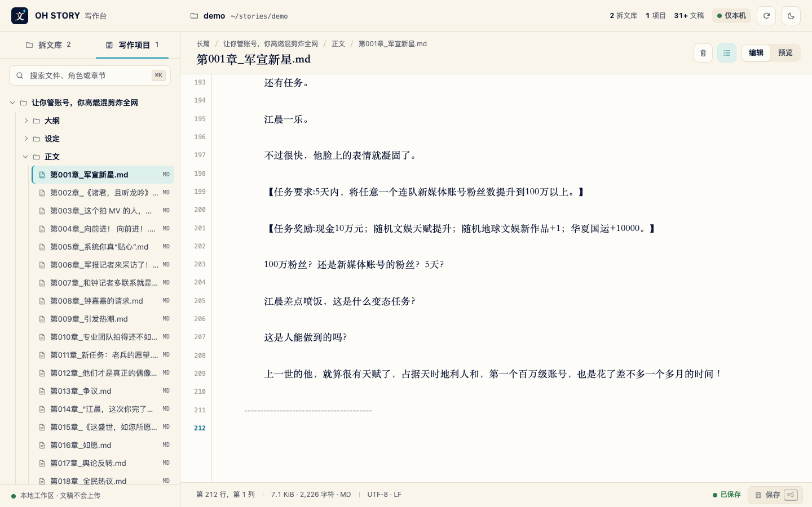
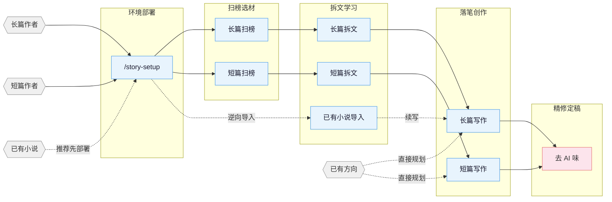

<p align="center">
  
</p>

<h1 align="center">Oh Story</h1>

<p align="center">
  <b>网文写作 skill 包：扫榜、拆文、写作、去AI味、封面图一套流程，装进你正在用的编程 Agent。</b>
</p>

<p align="center">
  <a href="https://zenstory.ai/zh/oh-story"><b>项目主页</b></a>
  &nbsp;·&nbsp;
  <a href="https://app.zenstory.ai/?utm_source=gh-oh-story&utm_medium=readme"><b>在线写作工作台</b></a>
  &nbsp;·&nbsp;
  <a href="#安装"><b>安装</b></a>
  &nbsp;·&nbsp;
  <a href="#常见问题"><b>常见问题</b></a>
  &nbsp;·&nbsp;
  <a href="README_EN.md"><b>English</b></a>
</p>

<p align="center">
  <a href="https://github.com/zenstory-ai/oh-story-claudecode/stargazers"></a>
  <a href="https://github.com/zenstory-ai/oh-story-claudecode/releases/latest"></a>
  
  <a href="./LICENSE"></a>
</p>

<p align="center">
  <a href="https://t.me/ohstoryclaudecode"></a>
  <a href="https://github.com/zenstory-ai/oh-story-claudecode/discussions"></a>
</p>

https://github.com/user-attachments/assets/8f9cc11b-1fb8-4cc5-a084-e0deb05ec791

## 这是什么

Oh Story 覆盖长篇与短篇网文全流程：**扫榜选材 → 拆解爆款 → 搭大纲写正文 → 去AI味 → 生成封面图**。它以 14 个 skill 的形式装进你正在用的编程 Agent，直接复用该工具的模型，无需显卡，也不用单独配模型。

- **用文件系统当记忆** — 设定、大纲、正文、追踪分目录保存，追踪数据统一记在 `追踪/_tracking-state.json` 里，自动生成状态卡、伏笔清单、角色状态与「作者真相 / 读者已知」双时间线；压缩上下文或换新会话后照样从文件接着写。
- **7 个专职角色与读写守卫** — 大纲、正文、一致性检查、人设、考据、书稿检索、拆书抽取各司其职；长篇缺细纲或追踪状态异常时先拦下，上一章追踪未入账等软条件会写前提醒，写完自动扫半截断章、大纲词漏入正文与常见 AI 腔（各 skill 按需加载参考资料，详见[架构与目录说明](docs/architecture.md)、[知识库清单](docs/knowledge-base.md)）。
- **适配 7 款编程 Agent** — Claude Code · Codex CLI · Google Antigravity · OpenCode · ZCode · OpenClaw · Reasonix；支持子代理与 hooks 的工具由 `/story-setup` 自动部署，其他能读项目文件的通用 Agent 环境也能按 skill 流程直接用。
- **面向主流长短篇平台** — 长篇覆盖起点中文网、番茄小说、晋江文学城、七猫小说、刺猬猫；短篇覆盖知乎盐言故事、番茄短篇、七猫短篇。

> **套路 = 确定性的情绪满足**

先**扫榜**摸清题材风口、人设与开篇切入点，再**拆文**扒出爆款的黄金三章、爽点节奏与钩子写法，最后用钩子、爽点和期待感搭自己的书。剧情走向由作者拍板，Agent 按敲定的方案推进。

## 安装

```bash
npx skills add zenstory-ai/oh-story-claudecode -y -g
```

`-g` 全局安装，所有目录可用；去掉 `-g` 只装到当前目录。**更新时重新执行同一条命令即可。**

也可以直接对编程 Agent 说一句话（支持导入 GitHub 仓库或 skill 的工具都适用，例如 WorkBuddy，见社区写的[开书实操](https://zhuanlan.zhihu.com/p/2087452622655592204)）：

```
安装这个 skill https://github.com/zenstory-ai/oh-story-claudecode
```

装好后，在写作项目根目录运行 `/story-setup`（Codex 用 `$story-setup`）部署当前工具支持的 hooks、子代理与参考资料，**随后新开会话**。也可在 [ClawHub](https://clawhub.ai/) 查找，发布范围见 [ClawHub 发布清单](.clawhub/publish.json)。

> 各编程 Agent 的部署差异、已知限制与安装排查（Windows `ENOENT`、Antigravity `agy -p`、旧目录残留等）见 **[部署与安装排查](docs/hosts.md)**。版本记录见 [CHANGELOG.md](CHANGELOG.md) 和 [Releases](https://github.com/zenstory-ai/oh-story-claudecode/releases)，旧项目更新见[升级指南](skills/story-setup/UPGRADING.md)。

## 看看实际效果

以下示例均来自 skill 真实运行产出（外加一段专门构造的 AI 腔反例），完整文件见 **[demo/](demo/README.md)**。

### 续写状态卡：连载几百章不崩盘

以作者自己的长篇为例：先用 `/story-import` 把已发布的 20 章整理成连载工程，开写第 21 章前的 `追踪/上下文.md` 如下。动笔前只挑本章用得上的状态，连同本章细纲、相关设定与出场角色卡交给写手，不把整张状态卡塞进提示词：

```markdown
## 当前位置
- 当前章：第20章   卷：第一卷·军宣整顿   故事时间：《如愿》点击破亿后的第二天

## 长期约束
- 军宣爽点必须通过作品效果、传播数据和围观反应链兑现，不能只靠系统播报。
- 钟嘉嘉未公开的军方培养安排属于作者真相，正文揭示前不能当成读者已知。

## 活跃伏笔
- F016｜钟嘉嘉并非普通军报实习生，她的军方家庭背景仍未完全公开｜埋第7章｜回收章未定｜高
- F049｜吴伟收到寻衅滋事公诉通知，最终法律结果尚未落地｜埋第18章｜回收章未定｜高
- F054｜一位老兵邀请江晨上门听当年的故事，为后续创作提供入口｜埋第20章｜回收章未定｜高

## 下一章承诺
- 先补第21章细纲，再承接老兵邀请、新歌伴奏和钢琴能力。
```

**「作者真相」与「读者已知」分开记录**，防止角色未卜先知或提前漏出伏笔。完整文件：[`demo/长篇/.../追踪/上下文.md`](demo/长篇/让你管账号，你高燃混剪炸全网/追踪/上下文.md)

### 续写第 21 章：从补细纲、写正文到追踪回写

顶部视频录的就是这次运行——`/story-long-write 写第21章` 一次跑完的产出与检查：

```text
细纲       细纲_第021章.md              追踪里写着「第21章尚无细纲」，skill 先补纲：单元 L1-03、目标情绪、本章标价、闭环状态、10 个情节点四列表格（外加可选的展开粒度列）
章级检查   storyctl.js chapter check   ready · 字数 2068 / 目标 2300
             ├ check-ai-patterns.js     0 命中
             ├ check-degeneration.js    0 命中
             └ normalize-punctuation    0 命中
追踪提交   storyctl.js chapter commit  tracking_committed=true · state_revision 0 → 1
追踪文件   tracking_commit.js check    上下文.md / 伏笔.md / 角色状态/ / 时间线/ / 逐章记录/ 全部由 state 重生成，逐字一致
```

细纲通过校验后，`narrative-writer` 分两段写完正文，核对设定与伏笔、按需去味润色，再跑完收尾检查。提交后，所有追踪文件都从 `_tracking-state.json` 自动重生成，不用手动维护；对照写前状态卡，本章实际回写了这些变化（节选）：

```diff
 ## 当前位置
-- 当前章：第20章   场景：火箭军文工团，钟嘉嘉送来老兵书法礼后
+- 当前章：第21章   场景：火箭军文工团办公室，江晨收到谭守义地址回信后
 ## 活跃伏笔
-- F054｜一位老兵邀请江晨上门听当年的故事，为后续创作提供入口｜埋第20章｜回收章未定｜高
+- F054｜谭守义已给邻市地址，江晨定次日上门听故事｜埋第20章｜第22章｜高
+- F057｜谭守义有个讲了五十年没人听全过的故事，内容未揭示｜埋第21章｜第22章｜高
+- F058｜任务三：离别主题作品、开放日当天热度1000万+、限时14天｜埋第21章｜第27章｜高
 ## 下一章承诺
-- 先补第21章细纲，再承接老兵邀请、新歌伴奏和钢琴能力。
+- 江晨向周薄森请假出营，赴邻市听谭守义讲完整故事并录音，揭示F057。
 ## 连贯性风险
-- 第21章尚无细纲，不能直接写正文。
+- 谭守义故事的作者真相为候选（E015），作者可在第22章细纲前改；揭示前不当读者已知。
```

新出场的谭守义自动建好角色卡与状态文件；他那段未公开的往事作为候选真相（E015）记入 `时间线/作者真相.md`，`读者已知.md` 只留江晨读到的那句话，已解决的旧风险则归档进 `逐章记录/第021章.md`——**状态不会无声漏掉**。

成品：[`正文/第021章_离别怎么会开花.md`](demo/长篇/让你管账号，你高燃混剪炸全网/正文/第021章_离别怎么会开花.md) · [`大纲/细纲_第021章.md`](demo/长篇/让你管账号，你高燃混剪炸全网/大纲/细纲_第021章.md) · [`设定/角色/谭守义.md`](demo/长篇/让你管账号，你高燃混剪炸全网/设定/角色/谭守义.md) · [`追踪/逐章记录/第021章.md`](demo/长篇/让你管账号，你高燃混剪炸全网/追踪/逐章记录/第021章.md)

### 长篇拆文：打分给出具体依据

`/story-long-analyze` 拆解《盘龙》前 23 章（约 6.2 万字，仅作分析素材），按番茄男频升级流读者的阅读习惯打分：

| 维度 | 评分 | 说明（节选） |
|------|------|------|
| 开篇钩子 | 2 | 前 500 字纯地理定位 + 晨练群像，无悬念 / 冲突 / 反差，靠「平民努力出头」慢渗。代入扎实但即时拉力弱。 |
| 主角塑造 | 4 | 延迟点名（第 60 段才点名）+ 他人惊叹引出，「衰败贵族 + 六岁神童」反差立人设。三章里最强项。 |
| 爽点设计 | 1 | 三章零传统爽点，爽感被刻意延迟到第 18 章金手指登场，赌代入复利。 |

> **综合**：三章是「立人设强、给爽点零」的极端结构。直接照搬会劝退番茄读者，
> 但拆出来的局部技法（导师代言设定、延迟点名、身体反应外化）高度可复用。

完整报告：[`demo/拆文库/盘龙/拆文报告.md`](demo/拆文库/盘龙/拆文报告.md)

### 短篇拆文：把旧作拆成可复用的结构

`/story-short-analyze` 拆解作者自己的短篇《曾将爱意私藏》（约 8,500 字，追妻火葬场 · 死遁），抽出 54 个情节节点与 11 项写作手法，逐段锚定原文并标出情绪走向（−9~+9）：

| 原文 | 抽出的结构 |
|---|---|
| 「霍总还不打算让沈暮月母子进门吗？」<br>「没必要，私生子而已。」<br>我正准备推门而入，听到这话，手停在了半空。 | **N1 门口偷听到「私生子而已」**<br>类型{信息} · 情绪{震惊}{−7}<br>手法{开篇即冲突+信息差} |
| 霍庭煜对我没有爱。<br>我默然抽回了手。<br>该放弃自己的执念了。 | **N2 认清对方无爱，决意放弃执念**<br>类型{情绪} · 情绪{心酸}{−5} |

同一份产出里，`写作手法.md` 直接点出原作的短板：

> **第一人称视角的局限**：男主的转变缺少情节铺垫，到 N47 才靠大段内心独白把「早就原谅、夜不能寐、深爱」一次性倒出来，
> 光靠心理说明，没用细节和行动演出来——这是第一人称追妻文的通病。

写新篇时，`/story-short-write` 直接调用这份报告、情节节点与手法卡构思。完整产出：[`demo/拆文库/曾将爱意私藏/`](demo/拆文库/曾将爱意私藏/)

### 去 AI 味：先跑句式扫描，再按语境改稿

`/story-deslop` 先用本地脚本扫描高频 AI 句式，标出行号、片段与改写方向。扫描一段人工构造的 AI 腔反例，共命中 8 处（3 处需复核 / 5 处建议）：

```text
改前.md:7:20     [review_required] em-dash             (么叫做命运的安排——不是巧合，而是一)
改前.md:23:6     [review_required] trailer-ending      (才刚刚开始)
改前.md:25:1     [review_required] trailer-ending      (没人知道)
改前.md:7:22     [advisory]        not-is-comparison   (不是巧合，而是一种冥冥之中的注定)
改前.md:11:1     [advisory]        negation-parade     (没有犹豫，没有生涩，)
改前.md:19:3     [advisory]        voice-contrast      (声音不大，却)
改前.md:21:2     [advisory]        not-is-comparison   (不是一次简单的弹奏，而是一场蓄谋已久的惊艳亮相)
改前.md:3:1      [advisory]        cliche-density-tic  (仿佛 一丝 深吸一口气 缓缓 微微)
```

第 21 章正文同一场戏跑同一套检查：**零命中，exit 0**。两段字数相近，改前用抽象判词替读者下结论，改后把人物的判断、对话和当场反应直接写出来。完整对照：**[demo/去AI味对照/](demo/去AI味对照/README.md)**

### 本地工作台与封面生成

运行 `/story dashboard`（Codex 用 `$story dashboard`）打开本地网页工作台，浏览拆文库与书稿目录，支持搜索、Markdown 预览、编辑保存与浅色/深色主题。服务仅监听 `127.0.0.1`，书稿不上传。

| 工作台 | `/story-cover` 生成的封面 |
|---|---|
|  |  |

## 安装后的第一条请求

复制对应的一条，把〈括号里的内容〉换成你的书即可开始：

1. **开一本新书（先盘黄金三章与人设）**
   > 我想开一本〈番茄男频都市脑洞 / 晋江古言穿书〉新书，核心卖点是〈一句话脑洞或金手指〉。先帮我理清已有的设定和还没定下来的地方，搭一个黄金三章的开篇框架（核心冲突、视角限制、前三章怎么起钩子和兑现爽点）。先别写正文，题材取舍、人物动机和后续走向等我拍板再动笔。
2. **导入已有书稿接着写**
   > 用 `/story-import` 把这份旧稿整理成连载项目。第 1–〈N〉章是定稿，〈文件名〉是第〈N+1〉章没写完的残稿；保留原稿别覆盖，残稿先别算正式章节，反推出来的人物设定和伏笔单列出来等我确认。先把章节范围、人物状态、前后矛盾的地方和待确认项列给我看，先不续写。
3. **改一段不得劲或 AI 味重的正文**
   > 用 `/story-deslop` 帮我改改这段戏，现在读着太〈水 / 像总结陈词 / 解释味太重〉了。别改剧情事实和人物当下知道的信息，也别提前漏出后面的伏笔；先挑出哪几句出戏，给一版改前改后对照和改法说明，不用全书通改，改哪几处由我定。

## 流程总览

扫榜和拆文按需选用，已有脑洞可以直接聊人设和大纲；正式写正文前，先在项目根目录跑一次 `/story-setup`。



## Skills

**日常写书用这 5 个就够**：装一次 `story-setup`，长篇用 `story-long-write`、短篇用 `story-short-write`，写完用 `story-deslop` 去 AI 味；拿不准叫哪个就直接说 `/story` 加一句话。

| Skill | 触发 | 说明 |
|:------|:-----|:-----|
| `story-setup` | `/story-setup` `$story-setup` `/准备写书` | 环境部署 · 适配 Claude/Antigravity/OpenCode/Codex/ZCode/OpenClaw/Reasonix 与通用环境（保留已有配置） |
| `story` | `/story` `$story` `/story dashboard` | 工具箱入口 · 按一句话需求转交对应 skill、记录写作习惯、打开本地工作台 |
| `story-long-write` | `/story-long-write` `/写长篇` | 长篇写作 · 大纲搭建、人物设定、正文写作、作者习惯管理 |
| `story-short-write` | `/story-short-write` `/写短篇` | 短篇写作 · 情绪设计、反转构思、精修出稿、作者习惯管理 |
| `story-deslop` | `/story-deslop` `/去AI味` | 去AI味 · 扫描高频 AI 句式并结合语境改稿 |

**按需选用的进阶工具**：拆对标书、扫榜、导入旧稿、多视角审稿、发布资料、生成封面。

| Skill | 触发 | 说明 |
|:------|:-----|:-----|
| `story-long-analyze` | `/story-long-analyze` `/长篇拆文` | 长篇拆文 · 黄金三章、爽点设计、节奏分析 |
| `story-long-scan` | `/story-long-scan` `/长篇扫榜` | 长篇扫榜 · 起点/番茄/晋江/七猫/刺猬猫榜单趋势 |
| `story-short-analyze` | `/story-short-analyze` `/短篇拆文` | 短篇拆文 · 故事核、结构、情感线、反转、写作手法与共鸣点 |
| `story-short-scan` | `/story-short-scan` `/短篇扫榜` | 短篇扫榜 · 知乎盐言/番茄/七猫/黑岩/点众等短篇热门选题 |
| `story-import` | `/story-import` `/导入小说` | 逆向导入 · 把已有书稿整理为可续写的标准目录 |
| `story-review` | `/story-review` `/审查` | 多视角审稿 · full / lean / solo 三档模式 + 番茄/起点/知乎评分标准 |
| `story-publish` | `/story-publish` | 发布准备 · 根据设定和大纲整理书名、简介与标签（当前适配番茄） |
| `story-cover` | `/story-cover` `/封面` | 封面生成 · 输出封面提示词或调用 GPT-Image-2 出图（Codex 内置额度 / API） |
| `browser-cdp` | `/browser-cdp` | 浏览器操控 · 复用本机浏览器登录态抓取榜单数据 |

> 本地检查区分硬底线与文风提示：退化截断、未闭合注释与机械标点硬伤直接阻断，`story-deslop` 的句式规则标为需复核（`review_required`，长篇可改写或附理由 `--ack` 放行）与建议项（`advisory`），按实际读感取舍；朱雀等外部检测工具仅作自测参考。

平时直接说白话也能触发：
- 「帮我开书」→ `story-long-write`
- 「整理番茄发布资料」→ `story-publish`
- 「这段太像 AI 写的了」→ `story-deslop`
- 「把我的旧稿导进来」→ `story-import`
- 「打开工作台」→ `story dashboard`
- 「记住我的写作习惯」→ `story` 转交写作 skill 记入作者习惯卡（保留原话、确认后生效、随时可改）
- 「沈栀现在什么状态」→ 检索书稿设定与追踪，环境支持子代理时交给 `story-explorer`

## 常见问题

### 已经写了一部分的小说，能导入后接着写吗？

可以。先在项目根目录运行 `/story-setup` 并新开会话，再用 `/story-import` 把旧稿反向拆成设定、大纲和追踪文件；核对完反推结果后，长篇用 `/story-long-write 写第N章`（先补该章细纲再动笔），短篇补完构思即可续写。反推一律以原稿写明的内容为准，详见[旧稿导入与续写指南](https://zenstory.ai/zh/oh-story/import-and-continue)。

### 长篇连载怎么避免前后矛盾、漏伏笔或角色未卜先知？

项目把「作者真相」「读者已知」和角色当前状态分别存成文件，每章动笔前只挑本章用得上的状态与待回收伏笔交给写手，写完再由脚本统一回写到 `_tracking-state.json`。具体机制见[长篇人设与连贯性说明](docs/ai-long-novel-character-consistency.md)，三章连写实操见[长篇连载一致性指南](https://zenstory.ai/zh/oh-story/long-novel-continuity)。

### 跑完 `/story-deslop` 去 AI 味，为什么外部检测器还可能标红？

`/story-deslop` 先用本地脚本清掉高频 AI 句式、破折号泛滥和复读截断，再由 Agent 顺着上下文把总结腔与空泛套话改回具体对话、判断和现场反应。目标是让读者读着自然不出戏，朱雀等外部检测工具仅作自测参考；具体改法见[去 AI 味文档](docs/how-to-remove-ai-flavor-from-web-fiction.md)与[改稿指南](https://zenstory.ai/zh/oh-story/revise-ai-prose)。

### Windows 上安装报 `ENOENT ... mkdir`，但最后显示 Done，算装好吗？

说明部分 skill 没装全。直接重跑同一条安装命令即可自动补齐；若参考资料目录仍有缺漏，运行 `/story-setup` 时会明确报错提醒。Windows 上的 Codex 用户还需在 Git 中开启 `core.symlinks=true`。

### 升级版本或换了编程 Agent 后要做什么？

先重跑安装命令并新开会话。如果新版本改动了项目内的子代理、hooks 或参考资料包，或者你换了另一款编程 Agent，在写作项目根目录补跑一次 `/story-setup` 再新开会话即可；各版本要求见[升级指南](skills/story-setup/UPGRADING.md)。

## 致谢

- <https://linux.do>
- <https://github.com/wen1701/FanqieRankTracker>
- <https://github.com/Sophomoresty/zhuque>

## ZenStory AI 项目

Oh Story 是 [ZenStory AI](https://zenstory.ai/zh) 开源故事创作与改编工具集的一部分（GitHub 组织：[zenstory-ai](https://github.com/zenstory-ai)）：

| 项目 | 用途 |
| --- | --- |
| [oh-story-claudecode](https://github.com/zenstory-ai/oh-story-claudecode) | 网文写作技能包：扫榜、拆文、大纲细纲、长短篇写作、伏笔追踪、去 AI 味与封面生成（本仓库） |
| [drama-skills](https://github.com/zenstory-ai/drama-skills) | AI 短剧与漫剧制作技能包：原著与对标拆解、剧本、视觉设定、分镜、生图/生视频提示词、确认后生产与剪辑成片 |
| [novel-to-game](https://github.com/zenstory-ai/novel-to-game) | 小说改游戏技能包：通读拆书、玩法与美术设计、代码构建与盲玩验收，支持网页、互动影游与微信/抖音/TapTap 小游戏 |
| [video-recap-skills](https://github.com/zenstory-ai/video-recap-skills) | AI 视频解说技能包：自动切镜、看画面写解说词、配音混音合成硬字幕成片，并可导出剪映 / CapCut 草稿 |
| [oh-story-dsh](https://github.com/zenstory-ai/oh-story-dsh) | DeepSeek Harness 社区插件：集成网文写作、短剧漫剧、小说改游戏与视频解说四个可视化工作台 |
| [zenstory](https://github.com/zenstory-ai/zenstory) | 对话即创作的 AI 小说与短剧网页工作台（[app.zenstory.ai](https://app.zenstory.ai)） |
