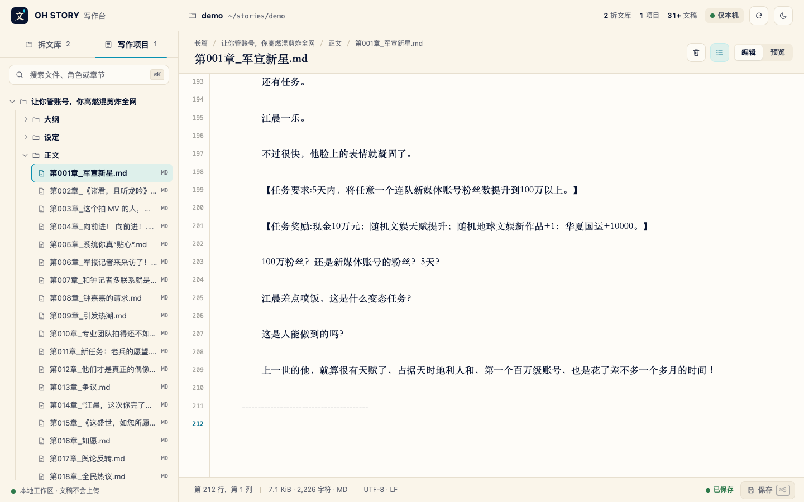
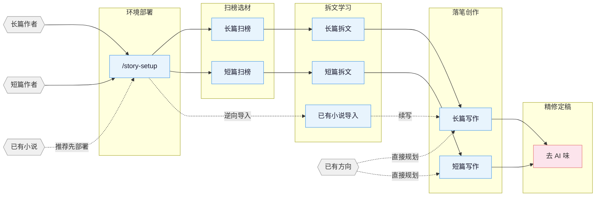

<p align="center">
  
</p>

<h1 align="center">Oh Story</h1>

<p align="center">
  <b>网文写作 skill 包：扫榜、拆文、写作、去AI味、封面图一套流程，装进你正在用的编程 Agent。</b>
</p>

<p align="center">
  <a href="https://zenstory.ai/zh/oh-story"><b>项目主页</b></a>
  &nbsp;·&nbsp;
  <a href="https://app.zenstory.ai/?utm_source=gh-oh-story&utm_medium=readme"><b>在线写作工作台</b></a>
  &nbsp;·&nbsp;
  <a href="#安装"><b>安装</b></a>
  &nbsp;·&nbsp;
  <a href="#常见问题"><b>常见问题</b></a>
  &nbsp;·&nbsp;
  <a href="README_EN.md"><b>English</b></a>
</p>

<p align="center">
  <a href="https://github.com/zenstory-ai/oh-story-claudecode/stargazers"></a>
  <a href="https://github.com/zenstory-ai/oh-story-claudecode/releases/latest"></a>
  
  <a href="./LICENSE"></a>
</p>

<p align="center">
  <a href="https://t.me/ohstoryclaudecode"></a>
  <a href="https://github.com/zenstory-ai/oh-story-claudecode/discussions"></a>
</p>

https://github.com/user-attachments/assets/8f9cc11b-1fb8-4cc5-a084-e0deb05ec791

## 这是什么

Oh Story 覆盖长篇与短篇网络小说的全流程：**扫榜选材 → 拆解爆款 → 搭大纲写正文 → 去AI味 → 生成封面图**。
它以 14 个 skill 的形式装进你已经在用的编程 Agent，写作用的模型就是该 Agent 的模型，不需要 GPU，也不需要另外配模型。

- **用文件系统当记忆** — 设定、大纲、正文、追踪分目录落盘。几十万字的长篇不靠对话记忆硬撑，压缩上下文或换新会话后，照样从文件读回当前进度、人物状态、伏笔和待填的坑。
- **写前守卫与写后去味** — 长篇没写细纲不直接动笔，写完自动扫半截断章、大纲词漏进正文和常见 AI 腔。支持 hooks 的宿主自动拦截和巡检，其他环境按 skill 流程走完检查。
- **适配 7 款编程 Agent** — Claude Code · Codex CLI · Google Antigravity · OpenCode · ZCode · OpenClaw · Reasonix；能读取项目文件的通用 Web AI / Agent 环境也可使用。
- **面向的平台** — 起点、番茄、晋江、七猫、知乎盐言等长短篇平台。

> **套路 = 确定性的情绪满足**

先**扫榜**摸清题材风口、人设与开篇切入点，再**拆文**扒出爆款的黄金三章、爽点节奏与钩子写法，最后用钩子、爽点和期待感搭自己的书。
设定、正文和追踪各自落盘，剧情方向由作者拍板，Agent 按敲定的方案推进。

## 安装

```bash
npx skills add zenstory-ai/oh-story-claudecode -y -g
```

`-g` 全局安装，所有目录可用；去掉 `-g` 则只装到当前目录。**更新时重新执行同一条命令即可。**

也可以直接对 Agent 说一句话（支持导入 GitHub 仓库 / skill 的平台都适用，例如 WorkBuddy，见社区写的[开书实操](https://zhuanlan.zhihu.com/p/2087452622655592204)）：

```
安装这个 skill https://github.com/zenstory-ai/oh-story-claudecode
```

装好后，在写作项目根运行 `/story-setup`（Codex 用 `$story-setup`）部署当前宿主支持的 hooks / agents / references，**然后新开会话**。

也可通过 [ClawHub](https://clawhub.ai/) 查找；本仓库的发布范围见 [ClawHub 发布清单](.clawhub/publish.json)。

> 各 Agent 的部署差异、已知限制与安装排查（Windows `ENOENT`、Antigravity `agy -p`、目录残留等）见 **[各编程 Agent 的部署与安装排查](docs/hosts.md)**。
> 版本与变更见 [CHANGELOG.md](CHANGELOG.md) 和 [Releases](https://github.com/zenstory-ai/oh-story-claudecode/releases)，已有项目的更新步骤见[升级指南](skills/story-setup/UPGRADING.md)。

## 看看它的输出

下面每一份都是 skill 跑出来的真实文件（外加一段专门构造的 AI 腔反例），完整文件在 **[demo/](demo/README.md)**。

### 续写状态卡：为什么连载几百章不崩盘

下面这本是项目作者自己的长篇，用 `/story-import` 把已发的前 20 章反向重建成可续写工程。
下面是**开写第 21 章之前**的状态卡。`/story-long-write` 靠
`追踪/上下文.md` 记账（固定 7 栏、上限 12 KiB），动笔前只挑本章用得上的状态交给写手，不把整张卡硬塞进正文提示词；本章细纲、相关设定和出场角色卡按需读取：

```markdown
## 当前位置
- 当前章：第20章   卷：第一卷·军宣整顿   故事时间：《如愿》点击破亿后的第二天

## 长期约束
- 军宣爽点必须通过作品效果、传播数据和围观反应链兑现，不能只靠系统播报。
- 钟嘉嘉未公开的军方培养安排属于作者真相，正文揭示前不能当成读者已知。

## 活跃伏笔
- F016｜钟嘉嘉并非普通军报实习生，她的军方家庭背景仍未完全公开｜埋第7章｜回收章未定｜高
- F049｜吴伟收到寻衅滋事公诉通知，最终法律结果尚未落地｜埋第18章｜回收章未定｜高
- F054｜一位老兵邀请江晨上门听当年的故事，为后续创作提供入口｜埋第20章｜回收章未定｜高

## 下一章承诺
- 先补第21章细纲，再承接老兵邀请、新歌伴奏和钢琴能力。
```

**「作者真相」和「读者已知」分开记录**——避免角色提前知道未公开的设定，或把还没揭晓的伏笔提前写破。
完整文件：[`demo/长篇/.../追踪/上下文.md`](demo/长篇/让你管账号，你高燃混剪炸全网/追踪/上下文.md)

### 续写第 21 章：从门禁到回写，一条链走完

上面的视频录的就是这一段。`/story-long-write 写第21章` 在一次真实会话里的产出与每一道检查：

```text
细纲       细纲_第021章.md              追踪里写着「第21章尚无细纲」，skill 先补纲：单元 L1-03、目标情绪、本章标价、闭环状态、10 个情节点四列表格（外加可选的展开粒度列）
章级检查   storyctl.py chapter check   ready · 字数 2068 / 目标 2300
             ├ check-ai-patterns.js     0 命中
             ├ check-degeneration.js    0 命中
             └ normalize-punctuation    0 命中
追踪提交   storyctl.py chapter commit  tracking_committed=true · state_revision 0 → 1
追踪文件   tracking_commit.py check    上下文.md / 伏笔.md / 角色状态/ / 时间线/ / 逐章记录/ 全部由 state 重生成，逐字一致
```

动笔前先过细纲与追踪门禁，细纲验收通过后，由 `narrative-writer` 分两段写正文。单章交稿前核对设定与伏笔（日更连写则在整批写完后集中核对），读感发虚或 AI 味重时再做去味润色，最后跑完本地收尾脚本与 `chapter check`。

提交之后，追踪状态是工具从 `_tracking-state.json` 整份重新生成的，**手改自动生成的追踪文件会被 `check` 拒绝**。
对照上面的状态卡，回写实际改了什么（节选，省略了同批滚动的近三章速记与角色状态）：

```diff
 ## 当前位置
-- 当前章：第20章   场景：火箭军文工团，钟嘉嘉送来老兵书法礼后
+- 当前章：第21章   场景：火箭军文工团办公室，江晨收到谭守义地址回信后
 ## 活跃伏笔
-- F054｜一位老兵邀请江晨上门听当年的故事，为后续创作提供入口｜埋第20章｜回收章未定｜高
+- F054｜谭守义已给邻市地址，江晨定次日上门听故事｜埋第20章｜第22章｜高
+- F057｜谭守义有个讲了五十年没人听全过的故事，内容未揭示｜埋第21章｜第22章｜高
+- F058｜任务三：离别主题作品、开放日当天热度1000万+、限时14天｜埋第21章｜第27章｜高
 ## 下一章承诺
-- 先补第21章细纲，再承接老兵邀请、新歌伴奏和钢琴能力。
+- 江晨向周薄森请假出营，赴邻市听谭守义讲完整故事并录音，揭示F057。
 ## 连贯性风险
-- 第21章尚无细纲，不能直接写正文。
+- 谭守义故事的作者真相为候选（E015），作者可在第22章细纲前改；揭示前不当读者已知。
```

新角色谭守义有了自己的设定卡和角色状态文件；他那个「讲了五十年没人听全过」的故事，真相候选（E015）记在
`时间线/作者真相.md` 并标为未揭示，`读者已知.md` 那一栏只有江晨看到的那句话。被退役的那条风险写进了
`逐章记录/第021章.md` 的「本章退役登记」——**状态不会无声漏掉**。

成品：[`正文/第021章_离别怎么会开花.md`](demo/长篇/让你管账号，你高燃混剪炸全网/正文/第021章_离别怎么会开花.md)
· [`大纲/细纲_第021章.md`](demo/长篇/让你管账号，你高燃混剪炸全网/大纲/细纲_第021章.md)
· [`设定/角色/谭守义.md`](demo/长篇/让你管账号，你高燃混剪炸全网/设定/角色/谭守义.md)
· [`追踪/逐章记录/第021章.md`](demo/长篇/让你管账号，你高燃混剪炸全网/追踪/逐章记录/第021章.md)


### 拆文报告：评分要给得出理由

`/story-long-analyze` 拆《盘龙》开篇 23 章（约 6.2 万字，起点经典，仅作拆解素材），按番茄男频升级流读者口味打分：

| 维度 | 评分 | 说明（节选） |
|------|------|------|
| 开篇钩子 | 2 | 前 500 字纯地理定位 + 晨练群像，无悬念 / 冲突 / 反差，靠「平民努力出头」慢渗。代入扎实但即时拉力弱。 |
| 主角塑造 | 4 | 延迟点名（第 60 段才点名）+ 他人惊叹引出，「衰败贵族 + 六岁神童」反差立人设。三章里最强项。 |
| 爽点设计 | 1 | 三章零传统爽点，爽感被刻意延迟到第 18 章金手指登场，赌代入复利。 |

> **综合**：三章是「立人设强、给爽点零」的极端结构。直接照搬会劝退番茄读者，
> 但拆出来的局部技法（导师代言设定、延迟点名、身体反应外化）高度可复用。

完整报告：[`demo/拆文库/盘龙/拆文报告.md`](demo/拆文库/盘龙/拆文报告.md)

### 短篇拆文：把自己的作品拆成可复用的模块

`/story-short-analyze` 拆《曾将爱意私藏》（作者自己的短篇，约 8,500 字，追妻火葬场 · 死遁），
产出 54 个情节节点、11 项写作手法。每个节点都锚定原文，并标注情绪类型与强度（−9~+9）：

| 原文 | 抽出的结构 |
|---|---|
| 「霍总还不打算让沈暮月母子进门吗？」<br>「没必要，私生子而已。」<br>我正准备推门而入，听到这话，手停在了半空。 | **N1 门口偷听到「私生子而已」**<br>类型{信息} · 情绪{震惊}{−7}<br>手法{开篇即冲突+信息差} |
| 霍庭煜对我没有爱。<br>我默然抽回了手。<br>该放弃自己的执念了。 | **N2 认清对方无爱，决意放弃执念**<br>类型{情绪} · 情绪{心酸}{−5} |

同一份产出里，`写作手法.md` 直接点出原作的代价：

> **POV 代价**：男主的转变缺乏过程展示，N47 的内心独白集中倒出「早就原谅、夜不能寐、深爱」，
> 略显直白说明（tell 多于 show）——这是第一人称追妻文的通病。

下游 `/story-short-write` 结合报告、情节节点、写作手法和原文构思新篇。
完整产出：[`demo/拆文库/曾将爱意私藏/`](demo/拆文库/曾将爱意私藏/)

### 去 AI 味：逐条匹配已知句式

`/story-deslop` 的本地检查是写作 lint：逐条匹配已知句式模板，
给出行号、命中片段和改写方向。拿一段人工构造的 AI 腔样例扫描，8 处命中（7 blocking）：

```text
改前.md:7:20     [blocking] em-dash             (么叫做命运的安排——不是巧合，而是一)
改前.md:7:22     [blocking] not-is-comparison   (不是巧合，而是一种冥冥之中的注定)
改前.md:11:1     [blocking] negation-parade     (没有犹豫，没有生涩，)
改前.md:19:3     [blocking] voice-contrast      (声音不大，却)
改前.md:21:2     [blocking] not-is-comparison   (不是一次简单的弹奏，而是一场蓄谋已久的惊艳亮相)
改前.md:3:1      [advisory] cliche-density-tic  (仿佛 一丝 深吸一口气 缓缓 微微)
```

取第 21 章正文中的同一场戏跑同一个扫描：**零命中，exit 0**。
两段字数几乎一样，差别在于改前用抽象判词替读者定性，改后把同一件事交给可见的动作和物件。

完整对照与全部 8 条命中：**[demo/去AI味对照/](demo/去AI味对照/README.md)**

### 本地写作工作台与封面

运行 `/story dashboard`（Codex 用 `$story dashboard`）打开本地工作台，浏览拆文库与长短篇项目文件树，支持搜索、Markdown 预览、文本编辑、冲突保护保存和确认删除。顶栏可切换浅色、深色；服务仅监听 `127.0.0.1`，小说内容不会上传。

| 工作台 | `/story-cover` 生成的封面 |
|---|---|
|  |  |

## 安装后的第一条请求

复制下面对应的一条，把〈括号里的内容〉换成你的书即可开始：

1. **开一本新书（先盘黄金三章与人设）**
   > 我想开一本〈番茄男频都市脑洞 / 晋江古言穿书〉新书，核心卖点是〈一句话脑洞或金手指〉。先帮我把已想好的设定和还没定下来的地方理出来，搭一个黄金三章的开篇框架（核心冲突、主角视角限制、前三章怎么起钩子和兑现爽点）。先别直接写正文，题材取舍、人物动机和后续走向等我拍板再动笔。
2. **导入已有书稿接着写**
   > 把这份旧稿导进来整理成连载项目（`/story-import`）。第 1–〈N〉章是定稿，〈文件名〉是第〈N+1〉章没写完的残稿；保留原稿别覆盖，残稿先别算成正式章节，反推出来的人物设定和伏笔单列出来等我确认。先把章节范围、人物状态、前后矛盾的地方和待确认项列给我看，先不续写。
3. **改一段不得劲或 AI 味重的正文**
   > 这段戏读着太〈水 / 像总结陈词 / 解释味太重〉了（`/story-deslop`）。别改剧情走向和人物当下知道的信息，也别把后面才揭晓的伏笔提前漏出来；先帮我指出哪几句出戏，给一版改前改后对照和改法说明，不要全书通改，改哪几处由我定。

## 流程总览

扫榜和拆文按需选用，有脑洞也可以直接聊人设和大纲；正式写正文前，先跑一次 `/story-setup` 部署项目。



## Skills

**先用这几个就够写书**：装一次 `story-setup`，之后长篇用 `story-long-write`、短篇用 `story-short-write`，写完用 `story-deslop` 去 AI 味；拿不准叫哪个就说 `/story` 加一句话。

| Skill | 触发 | 说明 |
|:------|:-----|:-----|
| `story-setup` | `/story-setup` `$story-setup` `/准备写书` | 环境部署 · Claude/Antigravity/OpenCode/Codex/ZCode/OpenClaw/Reasonix + generic（已有配置安全合并） |
| `story` | `/story` `$story` `/story dashboard` | 工具箱路由 · 模糊意图与作者习惯请求分发 + 本地拆文/项目 Dashboard |
| `story-long-write` | `/story-long-write` `/写长篇` | 长篇写作 · 大纲搭建、人物设定、正文输出、作者偏好管理 |
| `story-short-write` | `/story-short-write` `/写短篇` | 短篇写作 · 情绪设计、反转构思、精修出稿、作者偏好管理 |
| `story-deslop` | `/story-deslop` `/去AI味` | 去AI味 · 检测并清除 AI 写作痕迹 |

**进阶**：拆对标书、扫榜、导入旧稿、多视角审稿、发布资料、封面，需要时再用。

| Skill | 触发 | 说明 |
|:------|:-----|:-----|
| `story-long-analyze` | `/story-long-analyze` `/长篇拆文` | 长篇拆文 · 黄金三章、爽点设计、节奏分析 |
| `story-long-scan` | `/story-long-scan` `/长篇扫榜` | 长篇扫榜 · 起点/番茄/晋江市场趋势 |
| `story-short-analyze` | `/story-short-analyze` `/短篇拆文` | 短篇拆文 · 故事核、结构分析、情感线、反转设计、写作手法、共鸣分析 |
| `story-short-scan` | `/story-short-scan` `/短篇扫榜` | 短篇扫榜 · 知乎盐言/番茄短篇风口数据 |
| `story-import` | `/story-import` `/导入小说` | 逆向导入 · 将已有小说反向解析为标准项目结构 |
| `story-review` | `/story-review` `/审查` | 多视角审查 · full / lean / solo 模式 + 番茄/起点/知乎评分标准 |
| `story-publish` | `/story-publish` | 发布准备 · 用已有设定和大纲整理平台建书资料（书名、简介、标签），目前适配番茄 |
| `story-cover` | `/story-cover` `/封面` | 封面提示词或成图 · 成图调用 GPT-Image-2（Codex 内置用量 / API 回退） |
| `browser-cdp` | `/browser-cdp` | 浏览器操控 · CDP 协议复用登录态抓取数据 |

> `story-deslop` 的本地检查是写作 lint：blocking 只限确定性句式/标点问题，其他提示按读感判断；朱雀等外部检测只作自测参考，不替代人工读感。

自然语言同样触发：
- 「帮我开书」→ `story-long-write`
- 「整理番茄发布资料」→ `story-publish`
- 「这篇太 AI 了」→ `story-deslop`
- 「把我的书导进来」→ `story-import`
- 「打开工作台」→ `story dashboard`（本机浏览拆文库与写作项目，可轻量编辑）
- 「记住我的写作习惯」→ `story` 转交对应写作 skill 记进作者习惯卡（保留原话、确认后生效、改主意可覆盖）
- 「沈栀现在什么状态」→ 检索项目资料，宿主支持时交给 `story-explorer`

## 工作原理

文件、专职助手与 hooks 配合跑完写书闭环，细节见 **[工作原理：Agent、Hooks 与项目结构](docs/architecture.md)**。

**① 文件系统当记忆** — 一部长篇动辄几十万字。设定、大纲、正文、追踪拆成独立目录各自维护，
对话只负责创作，不负责记账。`追踪/` 下的 `_tracking-state.json` 是唯一底账，
自动生成上下文卡、伏笔账本、角色状态和「作者真相 / 读者已知」双时间线。

**② 7 个专职助手分工** — `story-architect` 排大纲与细纲，`narrative-writer` 写正文，`consistency-checker` 检查前后矛盾与伏笔遗漏，
其余分别管人物设定、考据查资料、书稿检索和拆书抽取。支持项目 Agent 的宿主由 `/story-setup` 部署，**部署后新开会话**；不支持的环境由主会话接管。

**③ 写前守卫与写后巡检** — 已接入正文守卫的宿主会在没写细纲就开写新章、或上一章追踪还没入账时直接拦下；写完自动扫半截断章和常见 AI 腔，命中硬伤时章级检查不放行。各宿主的 hooks 与回退方式见[部署说明](docs/hosts.md)。

各 skill 的 `references/` 按当前任务加载，未读取的资料不占上下文。全部主题清单见 **[知识体系](docs/knowledge-base.md)**。

## 适用平台

**长篇** 起点中文网 · 番茄小说 · 晋江文学城 · 七猫小说 · 刺猬猫

**短篇** 知乎盐言故事 · 番茄短篇 · 七猫短篇

真实产出样例见 [demo/](demo/)：短篇拆文《曾将爱意私藏》· 长篇拆文《盘龙》· 长篇续写工程《让你管账号，你高燃混剪炸全网》· 封面《剑道独尊》示例图。

这套 skill 现在能让我度过找工作的过渡期 :joy:，希望也能帮到有需要的朋友。

## 常见问题

### 能在 Codex、Google Antigravity、OpenCode 里用吗，还是只支持 Claude Code？

oh-story-claudecode 内置适配 Claude Code、Google Antigravity、OpenCode、ZCode、OpenClaw、Codex CLI 和 Reasonix。Codex 会直接扫描仓库内 `.agents/skills` 发现 14 个 skill，用 `$story-setup` 调用；Antigravity 用 `/skills` 或自然语言运行 `story-setup`，它会自动识别当前宿主（`target_cli=antigravity`）；OpenCode 需要 2.x，1.x 加载不了写正文守卫插件；能读取项目文件的 Web AI / Agent 环境也可以按通用 skills 路径使用。

### 需要 GPU 或自己部署模型吗？

不需要。oh-story-claudecode 是一组 skill，运行在你已经在用的编程 Agent 里，写作用的模型就是该 Agent 的模型；本地只跑确定性的检查脚本（Node / Python）。唯一的例外是 `story-cover` 封面生成，它调用 GPT-Image-2（Codex 内置用量或 API 回退）。

### 每章字数不统一、字数对不上怎么办？

从 v0.7.7 起，长篇正文只用一个机器统计的字数口径：每份细纲必须写明合法的「字数目标」，缺少时会停止而不是回退到 3000；欠字不会自动加戏，超字最多压缩一次。字数只由写作流程在交付前统一测量，写后 hook 不再提醒字数欠账。升级旧项目后重跑 `/story-setup` 并新开会话即可生效。

### 去AI味之后，朱雀等 AI 检测还是判定为 AI 怎么办？

`story-deslop`（`/去AI味`）先用本地脚本抓出已知的 AI 高频句式、破折号泛滥和复读截断，再由 Agent 顺着上下文把总结腔、空泛情绪和强行拔高改回具体动作与细节。核心目标是让读者读着顺畅不出戏；朱雀等外部检测工具仅作自测参考。
具体改法见[去 AI 味改稿指南](https://zenstory.ai/zh/oh-story/revise-ai-prose)，仓库内的规则说明见[去AI味的具体做法](docs/how-to-remove-ai-flavor-from-web-fiction.md)。

### 已经写了一部分的小说，能导入后继续写吗？

可以。先在写作项目根运行 `/story-setup`，新开或刷新会话后运行 `/story-import`（`/导入小说`）把已有书稿反向拆成设定、大纲和追踪文件，核对一遍反推结果，再用 `/story-long-write 写第N章` 续写（N 是导入后的下一章，会先补这一章细纲）；短篇导入后先补完构思再接着写。详见[旧稿导入与续写指南](https://zenstory.ai/zh/oh-story/import-and-continue)（一切以原稿写过的为准，不让模型瞎脑补）。

### 长篇连载怎么避免前后矛盾、忘伏笔或角色未卜先知？

把「作者真相」「读者已知」和「角色当下的认知」分开记录，每章动笔前只带本章用得上的状态与待回收伏笔。三章实操示例见[长篇连载一致性指南](https://zenstory.ai/zh/oh-story/long-novel-continuity)，本仓库的实现机制见[AI 写长篇小说怎么不崩人设：Oh Story 的做法](docs/ai-long-novel-character-consistency.md)。

### 细纲写得很全，为什么成文还是像大纲扩写、干巴巴复述设定？

因为细纲不能只列静态设定，得写清「这一章局面发生了什么变化」——主角想要什么、卡在哪、拿什么破局、付了什么代价，全落到视角人物眼皮底下的动作、对话和当场反应上。拆解示例见[细纲怎么落成正文场面](https://zenstory.ai/zh/oh-story/outline-to-chapter)。

### 怎么让 AI 顺着我的文风写，又不把样章里的人物和剧情串进来？

从你自己的旧作或参考片段里只抽句式节奏、叙述腔调和用词习惯，跟新书的人物设定分开存；样章只学行文味道，不抄原句、也不把旧书设定带进新书。详见[保留个人文风指南](https://zenstory.ai/zh/oh-story/preserve-author-voice)。

### Windows 上安装报 `ENOENT ... mkdir`，但末尾显示 Done，正常吗？

这是有技能没装全。无论有没有报错，重跑同一条安装命令即可修复；如果参考资料目录缺了一块，`/story-setup` 会提示参考资料包不完整。Codex 用户在 Windows 上还需要为 git 打开 `core.symlinks`。

### 升级到新版本后要做什么？

更新 skill 包后新开会话。若版本更新了项目内的 agents、hooks 或参考资料包，或你更换了编程 Agent，再在项目根重跑 `/story-setup` 并新开会话；具体版本要求见[升级指南](skills/story-setup/UPGRADING.md)。

### 短篇和长篇的入口有什么区别？

长篇：`/story-long-scan`（扫榜）→ `/story-long-analyze`（拆文）→ `/story-long-write`（写作，含大纲、卷纲、细纲、正文）。短篇：`/story-short-scan` → `/story-short-analyze` → `/story-short-write`。两条线共用 `/story-setup`、`/story-deslop`、`/story-review` 和 `/story-cover`。

## 延伸阅读

- [提示词、技能包、插件与 MCP 怎么分](https://zenstory.ai/zh/oh-story/agent-skills-for-writers) — 网文作者怎么选趁手的 AI 写作工具
- [导入 10–20 章后接着写](https://zenstory.ai/zh/oh-story/import-and-continue) — 旧稿反推设定与无缝续写实操
- [分开角色已知、承诺与线索](https://zenstory.ai/zh/oh-story/long-novel-continuity) — 避免长篇连载前后矛盾或角色未卜先知
- [把细纲要求写成看得见的场面变化](https://zenstory.ai/zh/oh-story/outline-to-chapter) — 细纲怎么写成有画面感的正文冲突
- [用具体改稿减少“AI 味”](https://zenstory.ai/zh/oh-story/revise-ai-prose) — 删掉总结腔和套话，把戏落回动作与细节
- [分开文风选择与本书事实](https://zenstory.ai/zh/oh-story/preserve-author-voice) — 让 AI 学你的行文腔调而不串戏
- [AI 写长篇小说怎么不崩人设：Oh Story 的做法](docs/ai-long-novel-character-consistency.md) — 仓库内文档
- [去AI味的具体做法](docs/how-to-remove-ai-flavor-from-web-fiction.md) — 仓库内文档
- [扫榜和拆文的自动化做法](docs/scan-charts-and-deconstruct-bestsellers.md) — 仓库内文档
- [Claude Code skills for writers](docs/claude-code-skills-for-writers.md) — 仓库内文档（英文）
- [黄金三章怎么写：网文开头清单与改写示例](docs/web-novel-golden-three-chapters.md) — 仓库内文档
- [网文断章技巧：章尾钩子怎么写、怎么选](docs/web-novel-chapter-ending-hooks.md) — 仓库内文档
- [小说细纲怎么写：章节模板与填写范例](docs/novel-chapter-outline-template.md) — 仓库内文档
- [小说人物设定集怎么整理：角色、时间线与人物已知信息模板](docs/novel-story-bible-template.md) — 仓库内文档
- [网文大纲怎么写：长篇大纲模板与分卷范例](docs/web-novel-outline-template.md) — 仓库内文档
- [开源 AI 写小说工具怎么选：10 个项目按使用方式对比](docs/open-source-ai-novel-writing-tools.md) — 仓库内文档
- [规则怪谈怎么写：规则开始冲突才可怕](docs/rules-horror-writing-guide.md) — 仓库内文档

## 贡献

欢迎贡献新 skill、补充知识库、更新市场数据。详见 [CONTRIBUTING.md](CONTRIBUTING.md)。

## 交流

- **Telegram 群**：<https://t.me/ohstoryclaudecode> —— 日常交流、踩坑、新功能讨论。
- **GitHub Discussions**：[提问 / 求助 / 分享用法](https://github.com/zenstory-ai/oh-story-claudecode/discussions)，方便检索。
- **GitHub Issues**：[Bug、输出质量 Case、功能请求](https://github.com/zenstory-ai/oh-story-claudecode/issues/new/choose)，请按结构化表单提供复现材料或具体输出证据。

## 贡献者

<a href="https://github.com/zenstory-ai/oh-story-claudecode/graphs/contributors"></a>

## 致谢

- [LINUX DO - The New Ideal Community](https://linux.do) — 社区支持
- [FanqieRankTracker](https://github.com/wen1701/FanqieRankTracker) — 番茄小说字体反爬解码方案参考
- [Zhuque AIGC Detector CLI](https://github.com/Sophomoresty/zhuque) — 去 AI 味实验中的外部复测工具参考

## ZenStory AI 项目

Oh Story 是 [ZenStory AI](https://zenstory.ai/zh) 的一部分——一组开源的 AI 故事创作、改编与生产工具（GitHub 组织：[zenstory-ai](https://github.com/zenstory-ai)）。同组织项目：

| 项目 | 用途 |
| --- | --- |
| [oh-story-claudecode](https://github.com/zenstory-ai/oh-story-claudecode) | 网文写作 skill 包（本仓库） |
| [drama-skills](https://github.com/zenstory-ai/drama-skills) | AI 短剧 / 漫剧创作 skill 合集：剧本、资产、分镜、图片/视频提示词、独立审查 |
| [novel-to-game](https://github.com/zenstory-ai/novel-to-game) | 小说改编游戏 skill 合集：原著拆解、目标运行环境构建与实机运行验收 |
| [video-recap-skills](https://github.com/zenstory-ai/video-recap-skills) | 将支持的视频文件制作成中文解说，可选导出可编辑的剪映/CapCut 草稿 |
| [oh-story-dsh](https://github.com/zenstory-ai/oh-story-dsh) | DeepSeek Harness 社区插件，提供小说、短剧、游戏和视频解说工作台 |
| [zenstory](https://github.com/zenstory-ai/zenstory) | 对话即创作的 AI 小说写作工作台（[app.zenstory.ai](https://app.zenstory.ai)） |
