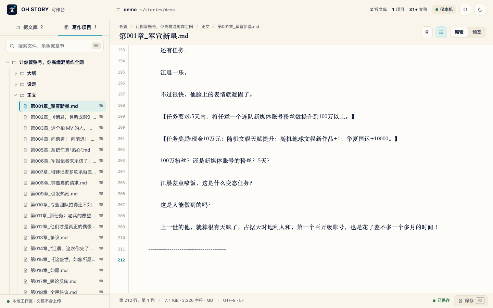
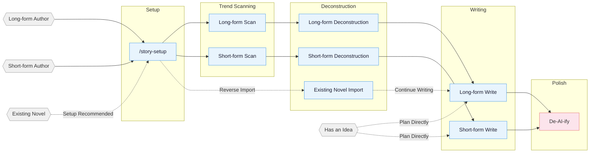

<!-- Last synced with README.md: 2026-11-22 -->

<p align="center">
  
</p>

<h1 align="center">Oh Story</h1>

<p align="center">
  <b>A skill pack for writing Chinese web fiction: chart scanning, deconstruction, drafting, de-AI editing, and cover art inside the coding agent you already use.</b>
</p>

<p align="center">
  <a href="https://zenstory.ai/oh-story"><b>Project page</b></a>
  &nbsp;·&nbsp;
  <a href="https://app.zenstory.ai/?utm_source=gh-oh-story-en&utm_medium=readme"><b>Web workbench</b></a>
  &nbsp;·&nbsp;
  <a href="#installation"><b>Install</b></a>
  &nbsp;·&nbsp;
  <a href="#faq"><b>FAQ</b></a>
  &nbsp;·&nbsp;
  <a href="README.md"><b>中文</b></a>
</p>

<p align="center">
  <a href="https://github.com/zenstory-ai/oh-story-claudecode/stargazers"></a>
  <a href="https://github.com/zenstory-ai/oh-story-claudecode/releases/latest"></a>
  
  <a href="./LICENSE"></a>
</p>

<p align="center">
  <a href="https://t.me/ohstoryclaudecode"></a>
  <a href="https://github.com/zenstory-ai/oh-story-claudecode/discussions"></a>
</p>

https://github.com/user-attachments/assets/8f9cc11b-1fb8-4cc5-a084-e0deb05ec791

## What it is

Oh Story covers the full web-fiction workflow for both serials and short stories: **chart scanning → bestseller deconstruction → outlining and drafting → de-AI editing → cover art**. It installs as 14 skills inside the coding agent you already use and runs on that agent's model—no GPU and no separate model setup required.

- **Files as memory** — settings, outlines, chapters, and continuity tracking live in separate directories, with `追踪/_tracking-state.json` as the single source of truth that generates the continuity card, foreshadowing ledger, character snapshots, and author-truth / reader-known timelines; after context compaction or a new session, writing picks right back up from disk.
- **7 specialist roles and read/write gates** — dedicated subagents handle outlining, drafting, continuity checks, character design, research, manuscript search, and chapter extraction; long-form gates hard-block drafting when a chapter outline or tracking state is missing/corrupt while flagging uncommitted prior chapters as soft pre-write advisories, and post-write checks catch cut-off endings, leaked outline jargon, and stock AI phrasing (references load on demand; see [Architecture & project layout](docs/architecture_EN.md) and [Knowledge base](docs/knowledge-base_EN.md)).
- **Built for 7 coding agents** — Claude Code · Codex CLI · Google Antigravity · OpenCode · ZCode · OpenClaw · Reasonix; `/story-setup` deploys native subagents and hooks where supported, while any file-capable Web AI or agent environment can run the skills directly.
- **Built for major Chinese fiction platforms** — Qidian (起点中文网), Fanqie (番茄小说), Jinjiang (晋江文学城), Qimao (七猫小说), and Ciweimao (刺猬猫) for serials; Zhihu Yanyan (知乎盐言故事), Fanqie Short-form, and Qimao Short-form for short stories.

> **Trope = reliable emotional payoff**

Start by **scanning charts** for trending premises, character archetypes, and opening angles, **deconstruct** how top books pace their opening three chapters, payoffs, and cliffhangers, then build your own story around clear hooks and anticipation. You make the creative calls; the agent executes the agreed plan.

## Installation

```bash
npx skills add zenstory-ai/oh-story-claudecode -y -g
```

`-g` installs globally across directories; omit `-g` to install into the current directory only. **To update, run the same command again.**

You can also ask your coding agent directly (works in any tool that imports GitHub repos or skills, such as WorkBuddy; see this [community walkthrough](https://zhuanlan.zhihu.com/p/2087452622655592204) in Chinese):

```
Install this skill https://github.com/zenstory-ai/oh-story-claudecode
```

Once installed, run `/story-setup` in your writing project root (`$story-setup` in Codex) to deploy the hooks, subagents, and references supported by your tool, **then start a fresh session**. You can also find the skills on [ClawHub](https://clawhub.ai/); published packages are listed in the [ClawHub inventory](.clawhub/publish.json).

> Per-agent deployment details, known limits, and install troubleshooting (Windows `ENOENT`, Antigravity `agy -p`, leftover directories) are in **[Agent deployment and troubleshooting](docs/hosts_EN.md)**. Release history is in [CHANGELOG.md](CHANGELOG.md) and [Releases](https://github.com/zenstory-ai/oh-story-claudecode/releases); existing projects can follow the [upgrade guide](skills/story-setup/UPGRADING.md) (Chinese).

## See what it produces

Every example below comes from real skill runs (plus one hand-built AI-flavored counterexample). Full files are in **[demo/](demo/README_EN.md)**.

### The continuity card: staying consistent across hundreds of chapters

Using the author's own serial as an example: `/story-import` turned 20 published chapters into a continuable project, producing this `追踪/上下文.md` continuity card right before chapter 21. Before drafting, only the state needed for the chapter—alongside its chapter outline, relevant world settings, and active character cards—goes to the writer rather than dumping the entire card into the prompt:

```markdown
## Current position
- Chapter 20 · Volume 1 · Story time: the day after "如愿" passed 100M views

## Standing constraints
- Propaganda payoffs must land through the work's real effect, reach data and bystander reaction —
  never through a system announcement alone.
- Zhong Jiajia's undisclosed military background is author-truth; it cannot be treated as
  reader-known until the prose reveals it.

## Live foreshadowing
- F016｜Zhong Jiajia is not an ordinary intern reporter｜planted ch.7｜payoff TBD｜high
- F049｜Wu Wei has received a criminal summons; the legal outcome has not landed｜planted ch.18｜high
- F054｜A veteran invited Jiang Chen to hear his story — an entry point for later work｜planted ch.20｜high

## Promises for the next chapter
- Write the ch.21 blueprint first, then pick up the veteran's invitation, the new backing track
  and the piano skill.
```

**Author-truth and reader-known are tracked separately** so characters never know secrets early or spoil unrevealed clues. Full file: [`demo/长篇/.../追踪/上下文.md`](demo/长篇/让你管账号，你高燃混剪炸全网/追踪/上下文.md)

### Chapter 21 end to end: outline, draft, and state write-back

The video at the top records this exact run—everything `/story-long-write 写第21章` produced and checked in one pass:

```text
Blueprint       细纲_第021章.md              tracking said "no blueprint for ch.21", so the skill wrote one first: unit L1-03, target emotion, stakes, loop state, a 10-row four-column plot table (plus the optional resolution column)
Chapter check   storyctl.js chapter check   ready · 2068 chars / target 2300
                  ├ check-ai-patterns.js     0 hits
                  ├ check-degeneration.js    0 hits
                  └ normalize-punctuation    0 hits
Tracking commit storyctl.js chapter commit  tracking_committed=true · state_revision 0 → 1
Derived views   tracking_commit.js check    上下文.md / 伏笔.md / 角色状态/ / 时间线/ / 逐章记录/ all re-rendered from state, byte-identical
```

Once the chapter outline passes validation, `narrative-writer` drafts the chapter in two parts, checks settings and foreshadowing, polishes AI phrasing if needed, and runs the closing checks. After commit, every tracking file is automatically re-rendered from `_tracking-state.json`; compared with the card above, here is what chapter 21 wrote back (excerpt):

```diff
 ## Current position
-- Chapter 20 · Scene: the propaganda troupe, after Zhong Jiajia delivers the veterans' calligraphy
+- Chapter 21 · Scene: the troupe office, after Jiang Chen receives Tan Shouyi's address
 ## Live foreshadowing
-- F054｜A veteran invited Jiang Chen to hear his story｜planted ch.20｜payoff TBD｜high
+- F054｜Tan Shouyi has sent his address; Jiang Chen will visit tomorrow｜planted ch.20｜payoff ch.22｜high
+- F057｜Tan Shouyi has a story "fifty years long that no one has heard to the end"; contents unrevealed｜planted ch.21｜payoff ch.22｜high
+- F058｜Task three: a "farewell" piece, 10M+ heat on open day, 14-day limit｜planted ch.21｜payoff ch.27｜high
 ## Promises for the next chapter
-- Write the ch.21 blueprint first, then pick up the veteran's invitation, the backing track and the piano skill.
+- Jiang Chen asks for leave, travels to the neighbouring city to hear Tan Shouyi's full story and records it; F057 revealed.
 ## Continuity risks
-- Chapter 21 has no blueprint yet; prose cannot be written directly.
+- The truth behind Tan Shouyi's story is a candidate (E015); the author may change it before the ch.22 blueprint; not reader-known until revealed.
```

New character Tan Shouyi automatically gets a profile card and state file; the unrevealed backstory behind his fifty-year secret (E015) is logged in `时间线/作者真相.md` while `读者已知.md` records only the single line Jiang Chen has read, and resolved risks are archived in `逐章记录/第021章.md`—**state never vanishes silently**.

Output: [`正文/第021章_离别怎么会开花.md`](demo/长篇/让你管账号，你高燃混剪炸全网/正文/第021章_离别怎么会开花.md) · [`大纲/细纲_第021章.md`](demo/长篇/让你管账号，你高燃混剪炸全网/大纲/细纲_第021章.md) · [`设定/角色/谭守义.md`](demo/长篇/让你管账号，你高燃混剪炸全网/设定/角色/谭守义.md) · [`追踪/逐章记录/第021章.md`](demo/长篇/让你管账号，你高燃混剪炸全网/追踪/逐章记录/第021章.md)

### Long-form deconstruction: scores backed by concrete reasons

`/story-long-analyze` on the first 23 chapters of *Coiling Dragon* (~62k characters, analyzed purely as study material), scored against what Fanqie progression-fantasy readers expect:

| Dimension | Score | Note (excerpt) |
|------|------|------|
| Opening hook | 2 | The first 500 characters are pure geography plus a morning-drill ensemble — no suspense, conflict or contrast. Immersion is solid, immediate pull is weak. |
| Protagonist | 4 | Named late (paragraph 60), introduced through others' astonishment; "declining noble house + six-year-old prodigy" sets the contrast. The strongest of the three chapters. |
| Payoff design | 1 | Zero conventional payoffs across three chapters; gratification is deliberately delayed to the chapter-18 cheat item, betting on compounding immersion. |

> **Overall**: an extreme structure — strong on character, zero on payoff. Copying this opening
> would lose Fanqie readers, but the local techniques it yields (exposition through a mentor,
> delayed naming, externalising resolve through the body) are highly reusable.

Full report: [`demo/拆文库/盘龙/拆文报告.md`](demo/拆文库/盘龙/拆文报告.md)

### Short-form deconstruction: turning past work into reusable structure

`/story-short-analyze` on the author's own short story *曾将爱意私藏* (~8,500 characters, "crematorium" / faked-death romance) extracts 54 plot nodes and 11 writing techniques, anchoring each beat to the original text with emotion type and intensity (−9 to +9):

| Source text | Extracted structure |
|---|---|
| 「霍总还不打算让沈暮月母子进门吗？」<br>「没必要，私生子而已。」<br>我正准备推门而入，听到这话，手停在了半空。 | **N1 Overhears "just a bastard child" at the door**<br>type{information} · emotion{shock}{−7}<br>technique{open on conflict + information gap} |
| 霍庭煜对我没有爱。<br>我默然抽回了手。<br>该放弃自己的执念了。 | **N2 Accepts he does not love her; resolves to let go**<br>type{emotion} · emotion{bitterness}{−5} |

In the same output, `写作手法.md` calls out a weakness in the original draft:

> **First-person blind spot**: the male lead's turn has little on-page buildup; at N47 an interior monologue dumps
> "long forgiven, sleepless, deeply in love" all at once instead of showing it through concrete actions—a classic
> weakness of first-person stories in this genre.

When planning a new short story, `/story-short-write` draws directly from this report, node list, and technique sheet. Full output: [`demo/拆文库/曾将爱意私藏/`](demo/拆文库/曾将爱意私藏/)

### De-AI editing: lint known patterns, then rewrite in context

`/story-deslop` runs a local prose linter that matches stock AI sentence patterns, reporting line numbers, spans, and rewrite directions. Scanning a hand-built AI-flavored passage catches 8 hits (3 review_required / 5 advisory):

```text
改前.md:7:20     [review_required] em-dash             (么叫做命运的安排——不是巧合，而是一)
改前.md:23:6     [review_required] trailer-ending      (才刚刚开始)
改前.md:25:1     [review_required] trailer-ending      (没人知道)
改前.md:7:22     [advisory]        not-is-comparison   (不是巧合，而是一种冥冥之中的注定)
改前.md:11:1     [advisory]        negation-parade     (没有犹豫，没有生涩，)
改前.md:19:3     [advisory]        voice-contrast      (声音不大，却)
改前.md:21:2     [advisory]        not-is-comparison   (不是一次简单的弹奏，而是一场蓄谋已久的惊艳亮相)
改前.md:3:1      [advisory]        cliche-density-tic  (仿佛 一丝 深吸一口气 缓缓 微微)
```

Running the exact same scan on the corresponding scene in chapter 21 returns **zero hits, exit 0**. Both passages are nearly the same length: the before version tells the reader what to feel in abstract summary, while the rewrite puts character judgment, dialogue, and reactions directly on the page. Full comparison: **[demo/去AI味对照/](demo/去AI味对照/README_EN.md)**

### Local workbench and cover generation

Run `/story dashboard` (`$story dashboard` in Codex) to open the local web workbench for browsing deconstruction libraries and book directories, complete with search, Markdown preview, conflict-safe editing, and light/dark themes. It binds only to `127.0.0.1` and never uploads your manuscript.

| Workbench | Cover from `/story-cover` |
|---|---|
|  |  |

## Your first request

Copy one of the prompts below and replace the 〈placeholders〉 with your own book:

1. **Start a new book (nail down the opening three chapters first)**
   > I want to start a new 〈Fanqie urban fantasy / Jinjiang transmigration〉 novel built around 〈one-line hook or cheat〉. Help me sort out what's already decided vs. still open, and sketch an opening framework for the first three chapters (core conflict, POV limits, and how each chapter sets hooks and pays off). Don't write prose yet—wait for my call on genre tradeoffs, character motives, and long-term direction.
2. **Import an existing draft and continue**
   > Use `/story-import` to turn this manuscript into a continuable project. Chapters 1–〈N〉 are final, and 〈filename〉 is an unfinished draft of chapter 〈N+1〉; keep the original files untouched, don't count the fragment as a finished chapter, and list inferred settings and foreshadowing separately for me to confirm. Show me the chapter range, character states, any contradictions, and open questions first—don't continue writing yet.
3. **Polish a flat or AI-sounding scene**
   > Use `/story-deslop` on this scene—it reads too 〈padded / like a summary / over-explained〉. Keep story facts, what the POV character currently knows, and unrevealed clues intact. Point out the lines that break immersion and give me a before/after comparison with brief notes on why—just this passage, not the whole book, so I can choose what to keep.

## Workflow overview

Chart scanning and deconstruction are optional—if you already have a premise, jump straight into character setup and outlining. Run `/story-setup` once in the project root before drafting prose.



## Skills

**These 5 cover everyday writing**: run `story-setup` once, write with `story-long-write` or `story-short-write`, and clean up AI phrasing with `story-deslop`; if you're unsure which skill to invoke, say `/story` followed by what you want to do.

| Skill | Trigger | Description |
|:------|:--------|:------------|
| `story-setup` | `/story-setup` `$story-setup` | Environment setup — configures Claude/Antigravity/OpenCode/Codex/ZCode/OpenClaw/Reasonix or generic projects (merges safely with existing config) |
| `story` | `/story` `$story` `/story dashboard` | Toolbox router — dispatches plain-language requests, manages writing preferences, and opens the local workbench |
| `story-long-write` | `/story-long-write` | Long-form writing — outlining, character design, chapter drafting, and author-preference management |
| `story-short-write` | `/story-short-write` | Short-form writing — emotional arcs, twist design, polished drafting, and author-preference management |
| `story-deslop` | `/story-deslop` | De-AI editing — lints stock AI patterns and rewrites passages in context |

**Optional specialist tools**: deconstruct benchmark books, scan platform charts, import old drafts, run multi-angle reviews, prep book-launch metadata, or generate covers.

| Skill | Trigger | Description |
|:------|:--------|:------------|
| `story-long-analyze` | `/story-long-analyze` | Long-form deconstruction — Golden Three Chapters, payoff cadence, and pacing analysis |
| `story-long-scan` | `/story-long-scan` | Long-form chart scan — market trends across Qidian, Fanqie, Jinjiang, Qimao, and Ciweimao |
| `story-short-analyze` | `/story-short-analyze` | Short-form deconstruction — story core, structure, emotional curve, twists, craft, and reader resonance |
| `story-short-scan` | `/story-short-scan` | Short-form chart scan — trending topics across Zhihu Yanyan, Fanqie, Qimao, Heiyan, and Dianzhong |
| `story-import` | `/story-import` | Manuscript import — reverse-parses existing chapters into a continuable project directory |
| `story-review` | `/story-review` | Multi-angle review — full / lean / solo modes with Fanqie, Qidian, and Zhihu rubrics |
| `story-publish` | `/story-publish` | Launch prep — turns settings and outlines into platform submission copy (title, synopsis, tags; Fanqie supported) |
| `story-cover` | `/story-cover` | Cover generation — builds cover prompts or generates images via GPT-Image-2 (Codex quota / API) |
| `browser-cdp` | `/browser-cdp` | Browser automation — scrapes chart data over CDP while reusing your logged-in browser session |

> Local checks separate hard defects from style: deterministic failures (degeneration/truncation, unclosed HTML comments, and mechanical punctuation issues) hard-block, while stylistic rules in `story-deslop` surface as `review_required` (rewrite or pass with an explicit `--ack` rationale in long-form) and `advisory` notes; external detectors like Zhuque are only a rough self-check.

Plain-language requests work too:
- `帮我开书` ("help me start a book") → `story-long-write`
- `整理番茄发布资料` ("prepare Fanqie launch details") → `story-publish`
- `这段太像 AI 写的了` ("this reads too much like AI") → `story-deslop`
- `把我的旧稿导进来` ("import my existing draft") → `story-import`
- `打开工作台` ("open the workbench") → `story dashboard`
- `记住我的写作习惯` ("remember my writing habits") → `story` routes to the writing skill to record your exact preference after confirmation
- `沈栀现在什么状态` ("what is Shen Zhi's current status?") → searches settings and tracking, delegating to `story-explorer` when subagents are supported

## FAQ

### Can I import a partially written novel and continue from there?

Yes. Run `/story-setup` in the project root and start a fresh session, then run `/story-import` to reverse-parse your manuscript into settings, outlines, and tracking files; after reviewing its inferences, continue a serial with `/story-long-write 写第N章` (which drafts chapter N's outline first) or finish planning a short story before writing on. Inferences strictly follow manuscript evidence rather than guessing—see the [import-and-continue guide](https://zenstory.ai/oh-story/import-and-continue).

### How does long-form writing avoid plot holes, dropped clues, or characters knowing too much?

The project stores author-truth, reader-known facts, and per-character state separately on disk, feeding each chapter only the active state and open clues it needs before committing updates back through `_tracking-state.json`. See [Keep an AI-written novel consistent over 100+ chapters](docs/keep-ai-novel-consistent-over-100-chapters.md) for the repository mechanics and the [long-novel continuity guide](https://zenstory.ai/oh-story/long-novel-continuity) for a three-chapter walkthrough.

### Why might external AI detectors still flag a chapter after `/story-deslop`?

`/story-deslop` runs local lint scripts to catch stock AI phrasing, em-dash overuse, and repetition before rewriting abstract commentary back into concrete dialogue, decisions, and scene reactions. Its goal is natural readability for human readers—external detectors like Zhuque are only a rough reference; see the [revision guide](https://zenstory.ai/oh-story/revise-ai-prose) and [in-repo lint details](docs/how-to-remove-ai-flavor-from-web-fiction.md) (Chinese).

### On Windows, installation prints `ENOENT ... mkdir` yet ends with `Done`. Did it work?

Some skills were only partially unpacked. Re-run the exact same install command to repair the missing files; if any reference bundle is still incomplete, `/story-setup` will flag it explicitly. Codex users on Windows should also enable `core.symlinks=true` in Git.

### What should I do after upgrading or switching coding agents?

Re-run the install command and start a fresh session. If the update changes project subagents, hooks, or reference bundles—or if you switch to another coding agent—run `/story-setup` once in your project root and open a new session; version-specific notes are in the [upgrade guide](skills/story-setup/UPGRADING.md) (Chinese).

## Acknowledgments

- <https://linux.do>
- <https://github.com/wen1701/FanqieRankTracker>
- <https://github.com/Sophomoresty/zhuque>

## Part of ZenStory AI

Oh Story is part of [ZenStory AI](https://zenstory.ai) — open-source tools for creating, adapting, and producing stories (GitHub org: [zenstory-ai](https://github.com/zenstory-ai)):

| Project | What it does |
| --- | --- |
| [oh-story-claudecode](https://github.com/zenstory-ai/oh-story-claudecode) | Web-fiction skill pack: chart scanning, deconstruction, outlining, long/short drafting, continuity tracking, de-AI-flavor polish, and covers (this repo) |
| [drama-skills](https://github.com/zenstory-ai/drama-skills) | AI short-drama & motion-comic skill suite: source/benchmark breakdown, scripts, visual settings, storyboards, image/video prompts, confirmed production, and final cuts |
| [novel-to-game](https://github.com/zenstory-ai/novel-to-game) | Novel-to-game skill pack: source analysis, gameplay & art design, builds, and blind-playtest QA for web games, interactive films, and WeChat/Douyin/TapTap mini-games |
| [video-recap-skills](https://github.com/zenstory-ai/video-recap-skills) | AI video-recap skill pack: auto shot-cutting, visual narration scripting, voiceover/mix with burned-in subtitles, and editable JianYing / CapCut draft export |
| [oh-story-dsh](https://github.com/zenstory-ai/oh-story-dsh) | Community DeepSeek Harness plugin bundling visual workbenches for novels, short dramas, games, and video recaps |
| [zenstory](https://github.com/zenstory-ai/zenstory) | Chat-to-create AI web workbench for novels and short dramas ([app.zenstory.ai](https://app.zenstory.ai)) |
